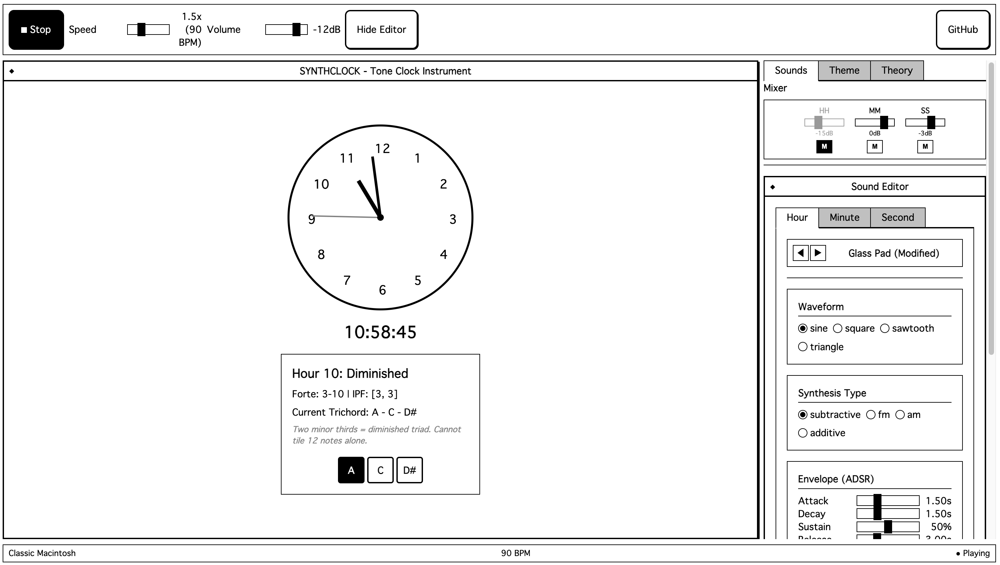

# 🎵 SynthClock



**Un instrumento musical generativo basado en el "Tone Clock" (Reloj Tonal) de Peter Schat.**

SynthClock traduce el paso del tiempo en música y efectos visuales reactivos. Cada segundo, minuto y hora se convierten en notas, acordes y texturas sonoras, generando una composición musical infinita que nunca se repite.

## ✨ Características

### 🎹 Motor de Audio

- **4 capas de sonido independientes**: Hour (drones ambientales), Minute (acordes melódicos), Second (pulsos rítmicos) y Arpeggiator
- **Síntesis polifónica** en tiempo real con Tone.js
- **Cadena de efectos completa** por canal: Filter → Tremolo → Delay → Reverb → Gate → Volume
- **Formas de onda**: Sine, Square, Sawtooth, Triangle
- **Filtros**: Lowpass, Highpass, Bandpass, Notch con resonancia ajustable
- **Efectos**: Reverb (con control de Wet y Decay independientes), Delay (con Feedback), Chorus, Distortion, Tremolo, Noise Gate
- **Presets de sonido** editables por capa con ADSR completo
- Actualización de parámetros en tiempo real sin cortes de audio

### 🎶 Arpegiador

- **Patrones**: Up, Down, UpDown, DownUp, Random
- **Rates**: 1/1 (whole), 1/2 (half), 1/4, 1/8, 1/16
- **Glissando**: Efecto portamento entre notas (0–2000ms)
- **Cadena FX dedicada**: MonoSynth → Filter → Delay → Reverb → Volume
- Presets de sonido melódicos (plucks, bells, leads)
- Sincronizado automáticamente al trichord actual del Tone Clock

### 🎨 Sistema Visual

- **4 tipos de efectos visuales**: Particles, Ripples, Droplets, Waves
- **Configuración por capa**: Cada canal (hour/minute/second/arp) tiene su propio efecto visual
- **Colores personalizables**: Theme, Pitch Class, Random o Custom por capa
- **Parámetros ajustables**: Intensidad, Tamaño, Decay, Opacidad, Posición (Center/Random/Clock Edge)
- **Modo Fullscreen** para experiencia inmersiva

### 🕐 Motor de Tiempo

- **Velocidad variable**: 0.1x a 10x (lento a rápido)
- **Modo Reversa**: El reloj puede avanzar hacia atrás
- **Visualización de fecha**: Muestra día, mes y año junto al reloj

### 🎛️ Mixer

- Control de **volumen y mute** independiente para cada canal
- Rango de volumen **−60 dB a +12 dB** por canal
- Persistencia de estado entre sesiones (via localStorage)

### 🎭 Temas Visuales

4 temas retro incluidos:
- **Classic Mac** — Interfaz clásica Macintosh
- **ANSI BBS** — Estética de BBS con caracteres ANSI
- **Terminal Green** — Terminal verde phosphor
- **Windows 3.1** — Estilo Windows clásico

### 🕰️ Panel del Tone Clock

El panel debajo del reloj muestra en todo momento:
- **Nombre del trichord activo** según la hora actual (ej. "Hour 9 — Quartal")
- **Descripción musical** del carácter sonoro
- **Las 3 notas que suenan** en secuencia, con la nota activa resaltada en tiempo real
- Indicación de cómo y cuándo cambia el grupo de notas

### 🎼 Teoría Musical

Basado en el **Tone Clock** de Peter Schat:
- **Hora** → selecciona el tipo de trichord (12 tipos únicos)
- **Minutos** → cambia la transposición del trichord cada 15 minutos
- **Segundos** → cicla entre las 3 notas del trichord actual (una por segundo)
- Teselación completa del espacio cromático de 12 notas
- [Más info sobre Tone Clock →](https://en.wikipedia.org/wiki/Tone_clock)

## 🚀 Quick Start

```bash
# Clonar el repositorio
git clone https://github.com/tu-usuario/synthclock.git
cd synthclock

# Instalar dependencias
cd app
npm install

# Iniciar servidor de desarrollo
npm run dev
```

Abre `http://localhost:5173` en tu navegador.

> **Nota**: Se requiere interacción del usuario (click) para iniciar el audio debido a las políticas del Web Audio API.

## 🏗️ Build para Producción

```bash
cd app
npm run build
npm run preview
```

## 📁 Estructura del Proyecto

```
synthclock/
├── README.md                    # Este archivo
├── ARCHITECTURE.md              # Arquitectura del sistema
├── ADDING_SOUNDS.md             # Guía para crear presets de sonido
├── ADDING_THEMES.md             # Guía para crear temas visuales
├── screenshot.png               # Captura de pantalla
├── Tone_clock.pdf               # Referencia teórica
└── app/                         # Aplicación React
    ├── src/
    │   ├── core/
    │   │   ├── audio/           # AudioEngine, Arpeggiator, Presets
    │   │   ├── theory/          # ToneClock (teoría musical)
    │   │   ├── time/            # TimeDilator (reloj virtual)
    │   │   └── visuals/         # VisualEngine, Themes, Renderers
    │   ├── components/
    │   │   ├── clock/           # ClockDisplay
    │   │   ├── editors/         # SoundEditor, VisualEditor, ThemeSelector
    │   │   ├── mixer/           # Mixer
    │   │   └── visuals/         # VisualCanvas
    │   ├── hooks/               # useStore (Zustand)
    │   ├── App.tsx              # Componente principal
    │   └── index.css            # Estilos
    └── package.json
```

## 🛠️ Tech Stack

| Tecnología | Uso |
|------------|-----|
| **React 19** | Framework UI |
| **TypeScript 5.9** | Tipado estático |
| **Vite 7** | Bundler y dev server |
| **Tone.js 15** | Motor de síntesis de audio |
| **Zustand 5** | Estado global con persistencia |
| **Vanilla CSS** | Estilos sin frameworks |

## 📖 Documentación

- [**ARCHITECTURE.md**](./ARCHITECTURE.md) — Arquitectura completa del sistema
- [**ADDING_SOUNDS.md**](./ADDING_SOUNDS.md) — Cómo crear presets de sonido
- [**ADDING_THEMES.md**](./ADDING_THEMES.md) — Cómo crear temas visuales

## 📄 Licencia

Este proyecto es de código abierto. Siéntete libre de modificarlo y experimentar.

## 📚 Referencias

- [Tone Clock — Wikipedia](https://en.wikipedia.org/wiki/Tone_clock)
- [Peter Schat](https://en.wikipedia.org/wiki/Peter_Schat) — Compositor holandés creador de la técnica
- [Tone.js Documentation](https://tonejs.github.io/)
## License

[CC BY-SA 4.0](LICENSE) — © Vladimiro Bellini ([vlasvlasvlas](https://github.com/vlasvlasvlas)). Ver [LICENSE](LICENSE) para los términos completos.
